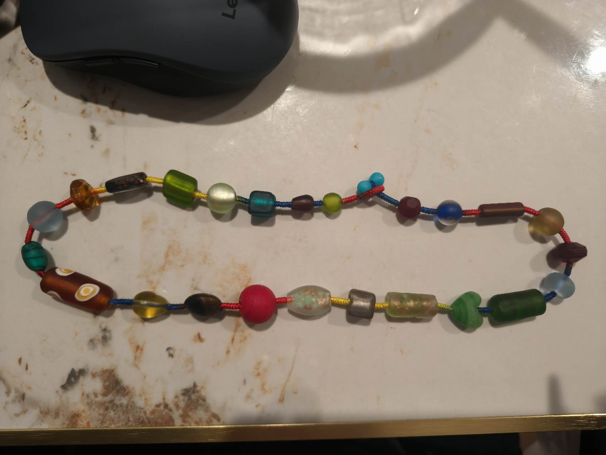

I have a string of necklace that I unconciously play around when my hands are free. So I thought it would be cool to play music with the beads on it, each plays a different note. I have zero knowledge of how sound work except a couple session of piano lesson when I was a kid. So I just went ahead and assign piano notes to the beads which are only graphics on the screen. I think playing music with the actual necklace could maybe be achieved by training the machine to recognize the color and shape of the beads, and track their movement and contact with fingertips.




# 01_loading_images

## Getting Started

Open `index.html` in your web browser and start editing `sketch.js`.

## Running Locally

For projects with media files, use a local server:

```bash
# Using Python
python -m http.server 8000

# Using Node.js
npx http-server

# Using VS Code Live Server extension
# Right-click index.html -> "Open with Live Server"
```

## Resources

- [p5.js 2.0](https://beta.p5js.org/)
- [p5.js Reference](https://p5js.org/reference/)
